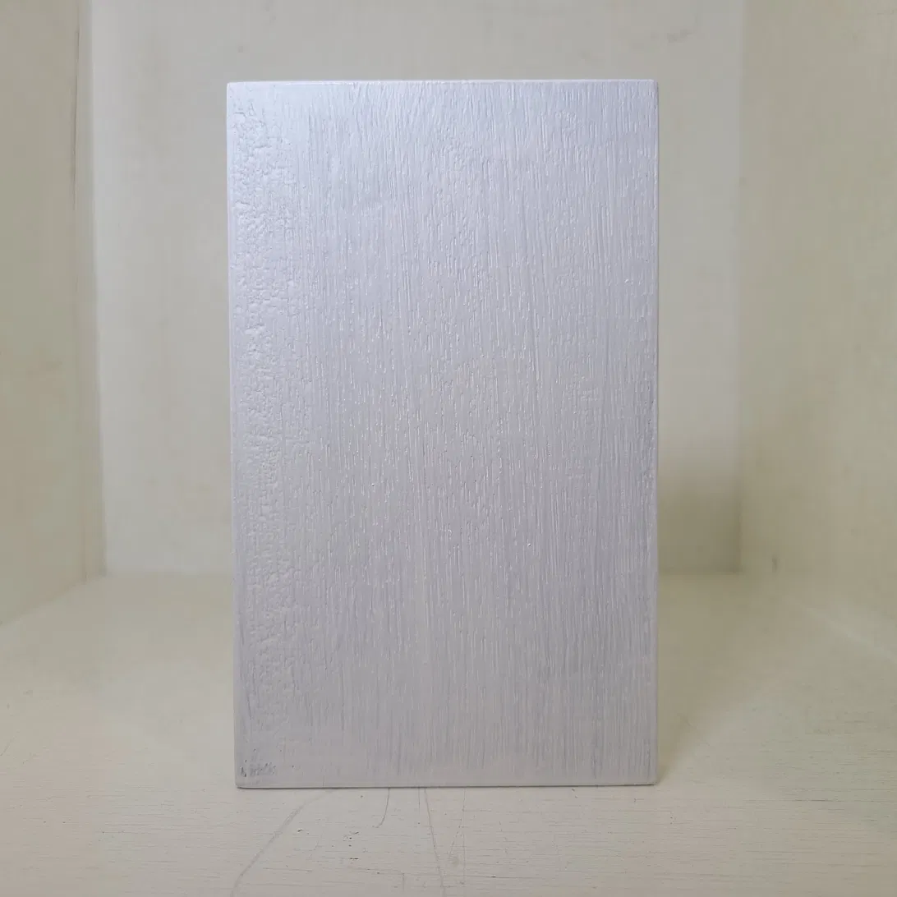
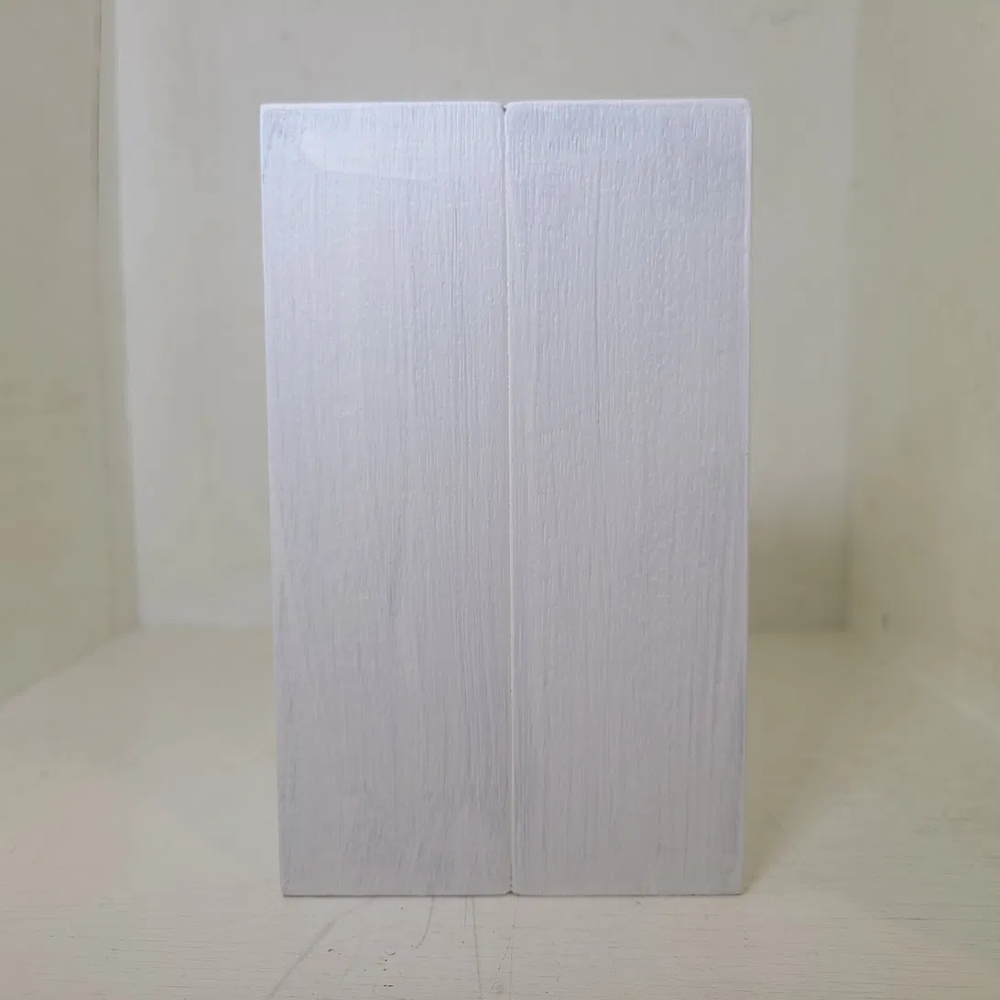
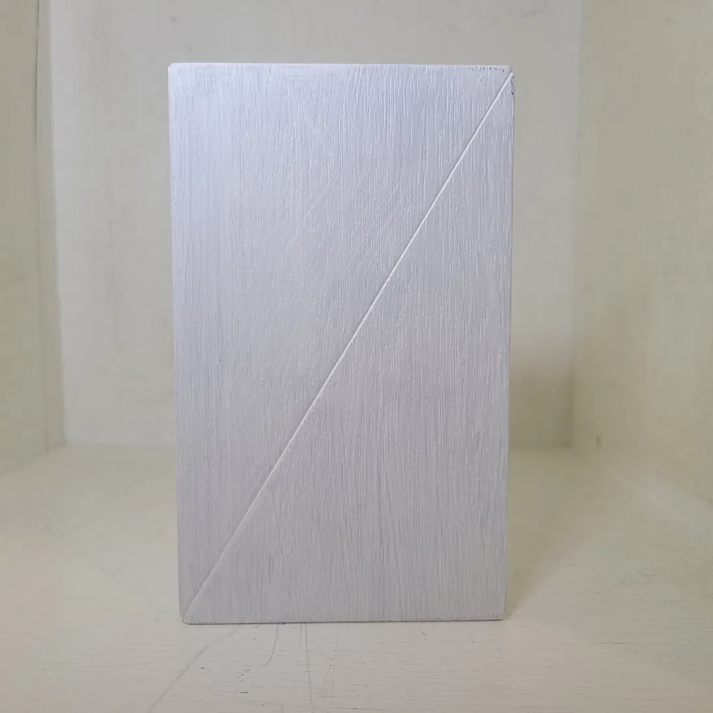
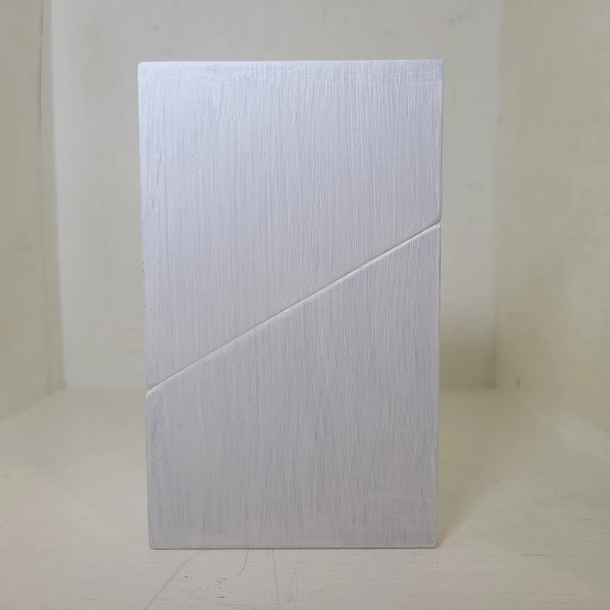
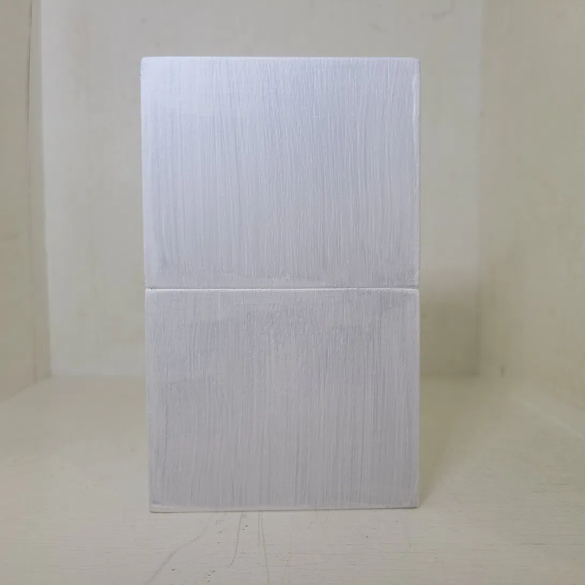

Material: Wood, acrylic paint (white)
Size: 15 × 9 × 1.5 cm

## Artist Statement

<!-- Paste your finalized bilingual artist statement here -->

"Structure demands, form responds, hands converge, the observer completes."

## Images

### Uncut

### Cut at 0°

#### [NFT #14: Cut at 0° (Angle Group) — View on OpenSea →](https://opensea.io/item/polygon/0xb5cf09c66e6deb732bb96b57b6a15d807a1c8905/14)

### Cut at 30°

#### [NFT #16: Cut at 30° (Angle Group) — View on OpenSea →](https://opensea.io/item/polygon/0xb5cf09c66e6deb732bb96b57b6a15d807a1c8905/16)

### Cut at 60°

#### [NFT #17: Cut at 60° (Angle Group) — View on OpenSea →](https://opensea.io/item/polygon/0xb5cf09c66e6deb732bb96b57b6a15d807a1c8905/17)

### Cut at 90°

#### [NFT #15: Cut at 90° (Angle Group) — View on OpenSea →](https://opensea.io/item/polygon/0xb5cf09c66e6deb732bb96b57b6a15d807a1c8905/15)

---

[← Back to Works](../../)
