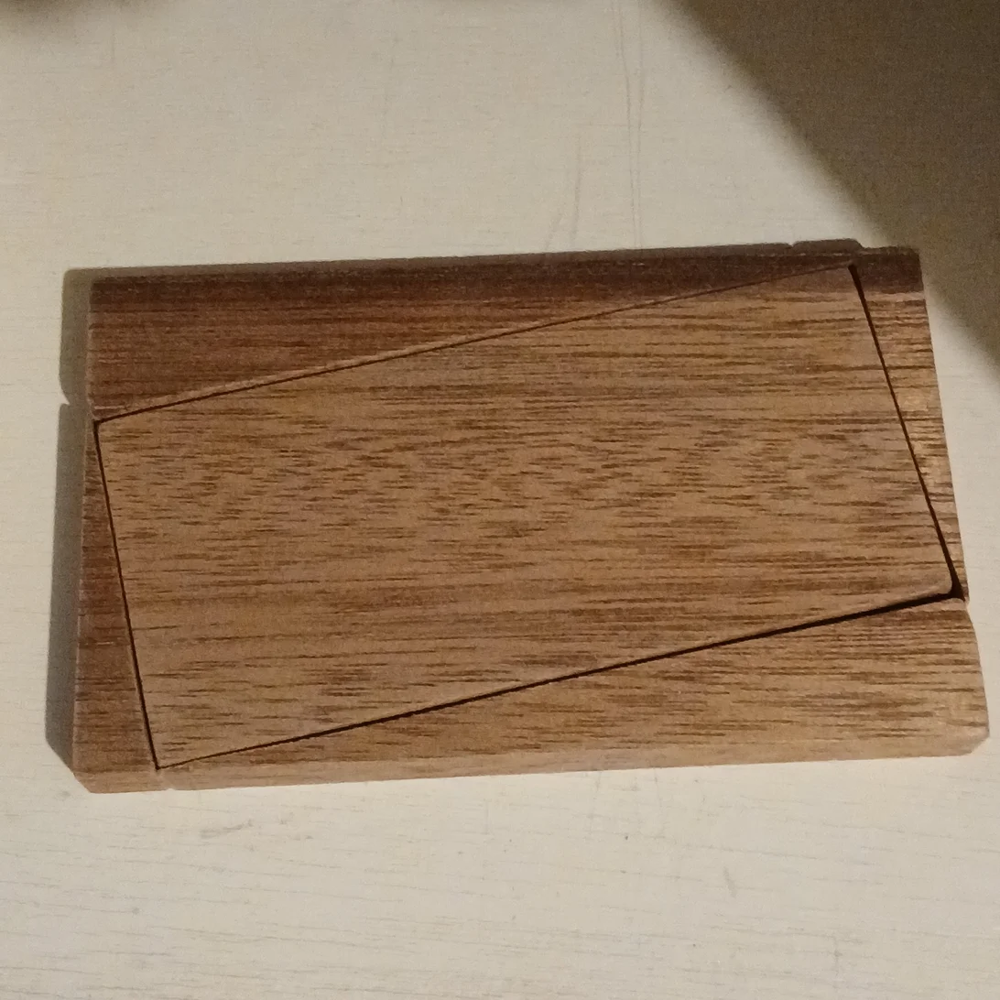
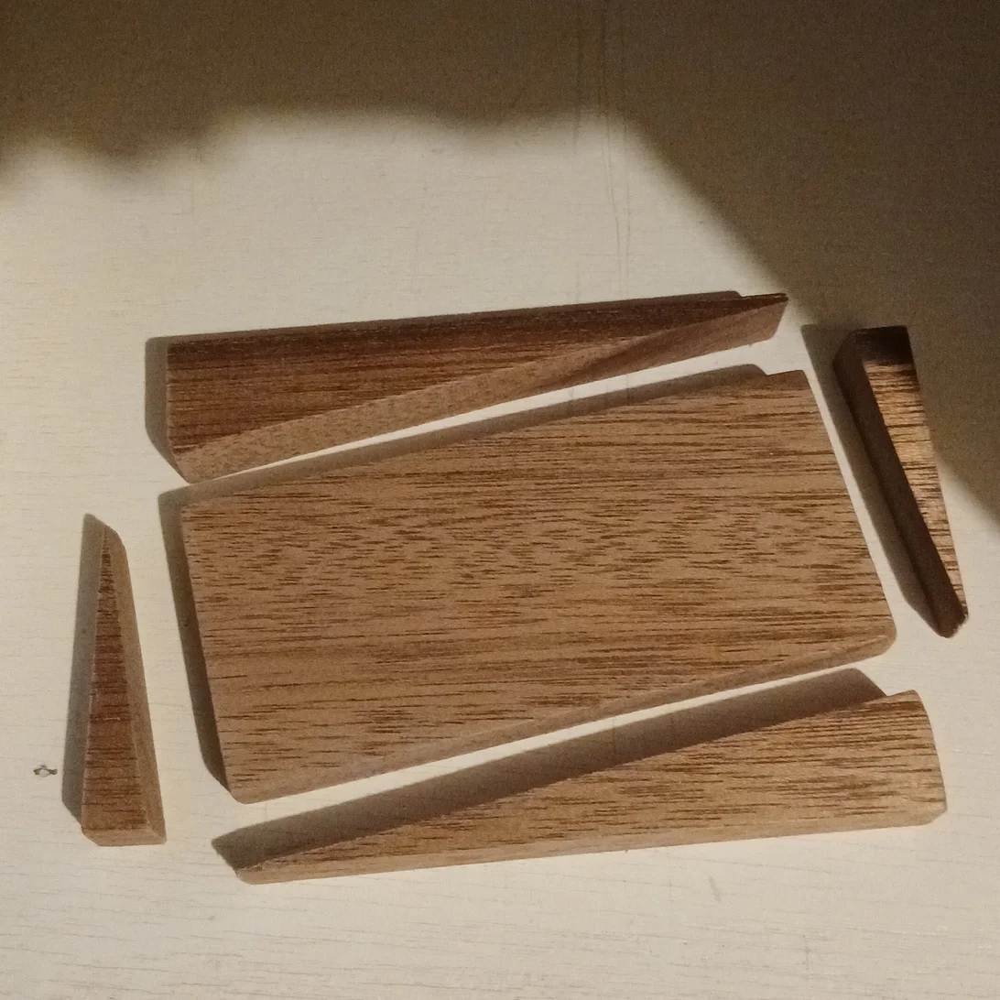
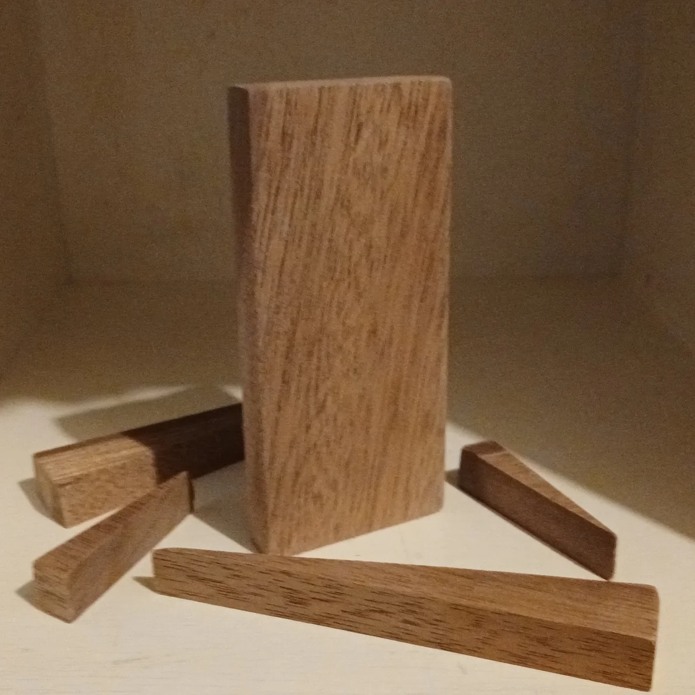

# Monolith 1 (2026)

*Experimental work — Cut & Build*

## How to Make a Monolith — Extraction by Erasure

This is not an instruction to "make a monolith." It describes one way a monolith can come into being.

**1. Assume a static singularity.**
Imagine something large — bedrock, a tree, the ground itself. Inside it, assume an as-yet-unrecognized point or region: a static singularity. 
Here, the monolith is conceived as a static singularity: a fully determined structure that exists as an assumption within a larger mass, rather than a form waiting to be discovered.It is an extremely determined structure, like 1 + 1 = 2, where the correspondence is closed, with nothing in excess and nothing missing. 
It is not a place where something happens, but a place where nothing more needs to happen.

**2. Assume, don't discover.**
The question is not "what is in here?" but "what if this is in here?" The direction of work reverses: the material no longer teaches the form. The assumption gives the material its boundary.

**3. Ignore the material's history.**
Grain, growth rings, strata — all record how the material came to be. Here they are deliberately not followed. This is less a dialogue with the material than a break from it.

**4. Extraction by erasure.**
The Michelangelesque image of a figure sleeping in the stone is *extraction by discovery*:

> material → discovery of form → extraction

Extraction by erasure runs differently:

> assumption → boundary → erase the rest → what remains

What is extracted is not a form found in the material, but what remains after everything other than the assumption is erased. Making is neither adding form nor discovering it. *Erase in order to keep.*

**5. What is cut away is not a "part" — it is a "retreat."**
In Cut & Build, cut pieces become parts to be rearranged. Here, the removed pieces are not components of the work. They withdraw to the side of the world so that the work can stand. There is no reassembly; only what remains appears as the final existence.

**6. A monolith is not a large block.**
Its shape need not be a rectangle. What matters is not the form but the conditions under which the form came to be — not what was made, but *what was kept and what was made to retreat*.

**7. A monolith is cut out of the world.**
The finished object does not reveal how it was made. Why this form, this direction, this place — those reasons are not inside the object; they have already been erased. Only what remains is there.

To make a monolith, then, can be redefined as:

> not to give form to matter, but to make everything else retreat so that one thing may remain.

Any material will do. Any form will do. Assume a static singularity inside something large, erase everything else according to that assumption, and see what remains.

Can what has been made in this way be called a monolith itself?

No. It is not the monolith itself. What has been extracted from an assumption is nothing more than a model of a monolith. I cannot create the monolith itself.

*Based on the author's note article "How to Make a Monolith — On Extraction by Erasure" (in Japanese, 30 August 2026).*

[← Back to Cut & Build](../../)
