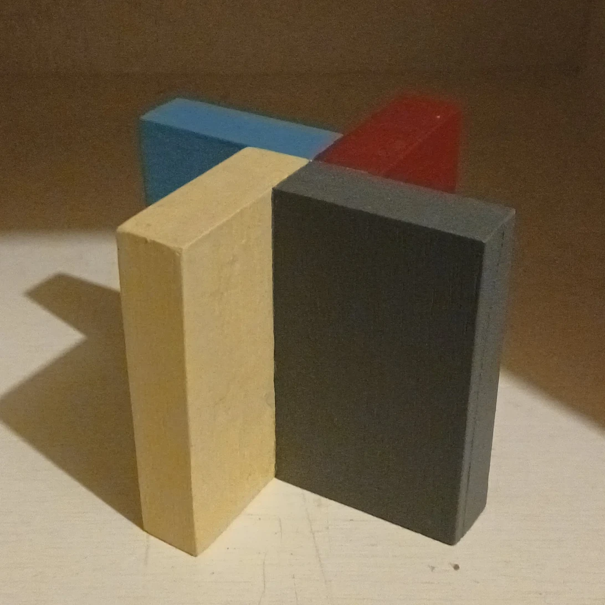
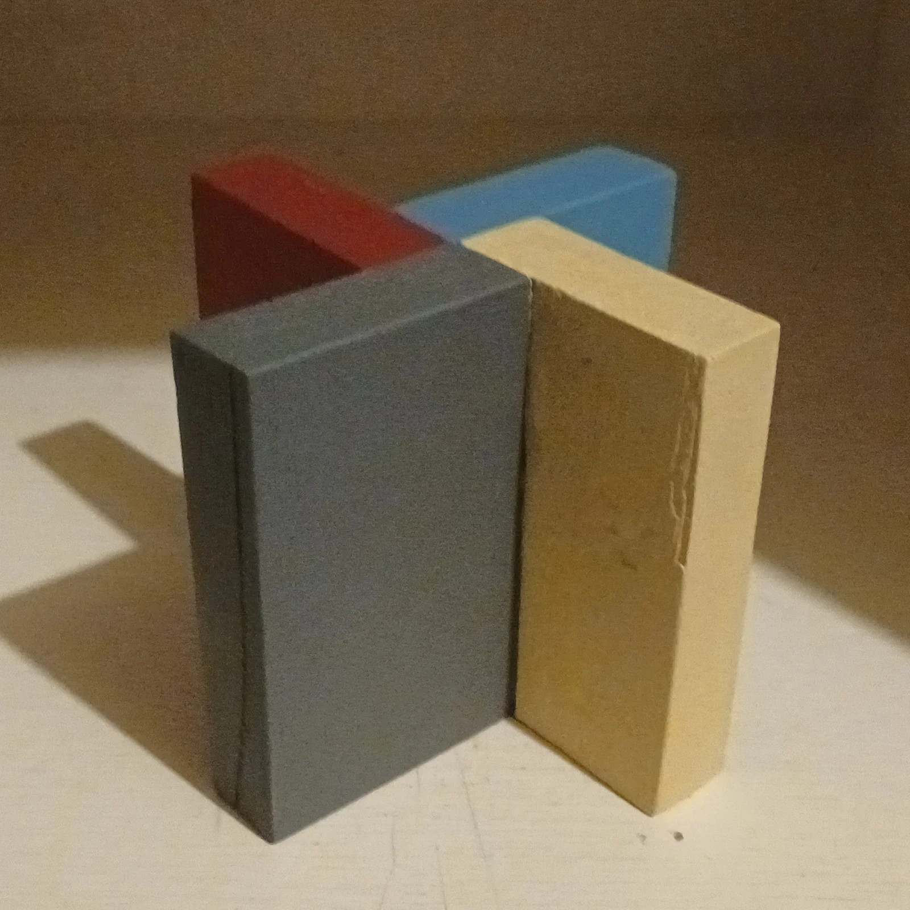

## Work line

## Statement

Uniform wooden boards, cut at 0° and 90° into four pieces. The four pieces are interlocked in a right-handed rotation, each painted in a single color: gray, beige, blue, red. After red, gray returns.

Work3 is a single, independent object — not a set of four, and not itself a relation. Its four colors, in this order, are those that the relations between work1a, work1b, work1c, and work1d already marked on the blockchain.

Turned upside down, the form becomes its mirror image and the cycle runs in reverse. In Work2, gravity determines which side is up. In Work3, gravity leaves the choice of up and down open. The first image shows the orientation in which Work3 is presented; the second shows it turned upside down.

This NFT does not describe why. It only states that Work3 stands in reference to those existing relations, not to any of the physical objects those relations once connected. Work3 may pass to another hand, as work1a, work1b, work1c, and work1d already have. This reference does not. It stays where anyone can find it, independent of who owns what it points to.

## Reference — Cycle: Gray / Beige / Blue / Red

Work3's four pieces carry gray, beige, blue, and red, in reference to the relations between work1a, work1b, work1c, and work1d — the cycle that closes on itself.

### [NFT: Reference — Work3 → Relations 1a–1d — View on OpenSea →](https://opensea.io/item/polygon/0xb5cf09c66e6deb732bb96b57b6a15d807a1c8905/20)

---

[← Back to Works](../../)
